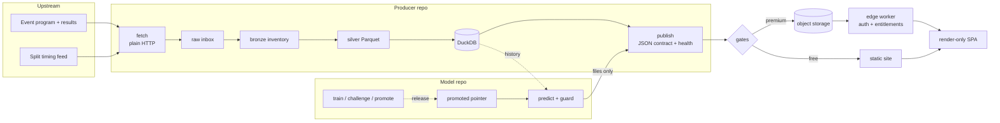

# Daily prediction pipeline

How the backend of a live subscription data product is built: fetch, warehouse, model, publish, deploy, every day, unattended, on one Linux box.

The product ranks the participants of scheduled sports events before they start and scores itself after results come in. Product name, market and sources are left out on purpose. The code is private; this repo is the architecture write-up.

## The shape



Two lanes, one direction:

- **Model repo** owns training, promotion and daily prediction.
- **Product repo** owns fetching, the warehouse, the publish contract, the web app and the daily orchestration.
- The model repo imports the product's core package. The product never imports model code. A test fails the build if it does. Predictions cross over only as files on disk (`summary.json` + `predictions.parquet` per day).

## A day

All jobs are user-level systemd timers on one Ubuntu machine, scheduled in the event market's timezone, never the machine's local date.

| When | Job |
| --- | --- |
| Morning | Evaluate yesterday, predict today, rebuild warehouse, publish, deploy |
| Midday | Full refresh |
| Before each event block | Pre-start refresh (4 times) |
| Afternoon to late evening | Results watch, polls every 7 minutes, deploys only when a new result lands |
| Twice a day | Watchdog |
| Evening + early morning | Fetch tomorrow's supporting data, retry what is missing |
| Every 10 minutes | Catch-up guards: rerun a missed daily or intraday step |

One file (`producer.enabled`) is the global kill switch. Every service checks it before doing anything.

## Warehouse

```
raw inbox  ->  bronze inventory  ->  silver Parquet  ->  DuckDB catalog
```

- Fetchers are plain `requests`, no browser automation.
- Bronze records what arrived and when. Silver is typed, canonical tables (program, results, per-segment timing).
- Every step is a CLI command; any non-zero exit aborts the run.
- Intraday results go to a separate provisional folder. They never write the canonical results manifest, so the next morning's authoritative fetch still runs instead of seeing "already done" and skipping.

## Model

- **Learning to rank.** LightGBM `lambdarank`, one booster per participant class plus a global fallback for classes it has not seen.
- **Score to probability.** Softmax per event (each event sums to 1), then temperature scaling per class.
- **~120 features** in families: event context and geometry, declarations, form and recency, speed norms, staff history, affinity to conditions, pace from past splits, end-of-event speed profile.
- **Leakage rule.** For an event at time `T`, only history strictly before `T` is used: `searchsorted(times, T, side="left")`, never `<=`. Results, margins and every market-derived field are banned as features. Market data exists only as a monitoring sidecar and never enters the ranking.
- **Audit columns.** Every feature row carries 6 of them: as-of time, latest history time used, rows available vs used, feature version, feature fingerprint.
- **Daily evaluation.** A fast eval runs next morning (hit@1/2/3, log loss, Brier, per venue). A reconcile step fetches the slow timing data later and upgrades the provisional eval without losing it.

## Fail closed

Nothing user-facing ships unless every gate passes.

1. **Prepublish guard**, runs after prediction files are written and before anything is published. It only reads files and never recomputes anything:
   - pointer integrity: the served model is the promoted one
   - output completeness: no venue silently dropped, row counts match the program
   - probability invariants: values in [0, 1], each event sums to 1.0 (atol 1e-6), rank 1 = max probability, no duplicate rows
   - eval honesty: no provisional eval presented as final
2. **Freshness check.** If today's prediction files are not from this run, web publish is skipped and the run exits 1.
3. **Health gate.** `publish_health.json` missing, `fail`, or any of 8 lanes null: exit 1. `warn`: continue.
4. **Bundle gate.** No day bundle, no deploy. No silent empty site.
5. **Order.** Premium data uploads to object storage first. If that fails, the free site is not deployed, so paying users never see older data than anonymous ones.

Failures go to a private admin Telegram chat, never to users. The warehouse still finishes, so a blocked publish loses no data.

## Releasing a model

Training happens on a separate machine. A promoted model reaches production only through a release:

```
release-build    manifest: sha256 per file + model repo git SHA + core package version
one-way sync     dev machine -> producer
release-verify   missing file, hash mismatch or unexpected file -> reject
release-install  copy, re-hash every file, only then move the pointer
```

The pointer file that decides which model is live is never edited by hand. A half-synced release fails verification instead of going live.

## Serving

- **Static contract.** The publish step writes versioned JSON (`publish_v1`) for a 3-day window (yesterday, today, tomorrow). The free site is static files on a CDN. No API for free content.
- **Render-only frontend.** React 19 + Vite. The frontend computes nothing: it reads stable codes and ready 0-100 numbers. Raw provider values never reach the screen.
- **Premium.** An edge worker checks auth and entitlements, then streams premium JSON from object storage. Payments and auth are plain `fetch` + WebCrypto, no SDK. One rule: premium content only ever lives on new private paths. Something that was public once is treated as cached forever and is never gated in place.
- **Analytics.** First-party, cookieless event endpoint on the same worker.
- **Rollback.** Deploys are idempotent per date, so rollback means redeploying the last healthy day's bundle.

## Lessons kept in the design

- **Twin scripts drift.** The orchestrators exist as `.sh` and `.ps1`. The Windows intraday script once deployed the site without the premium upload, so members saw older data than anonymous visitors. Production runs the Linux path; the asymmetry is documented, not hidden.
- **Publish moved behind the guard.** Publish used to run inside the unconditional warehouse sequence. It now has its own lane gated on the prediction exit code, and a stale prediction file blocks it too.
- **Production moved machines.** The producer ran on a Mac Mini with LaunchAgents, then moved to Ubuntu with systemd timers. Hosting, storage and auth stayed where they were; only the writer moved.

## Stack

Python 3.11+, pandas, Parquet, DuckDB, LightGBM, SHAP · React 19, Vite, TypeScript · edge workers, KV, object storage, SQL analytics DB · systemd user timers on Ubuntu · Syncthing for one-way release transport · Telegram for admin alerts.

About 2,800 tests across the three codebases (producer ~790, model ~1,000, web + worker ~1,070).
